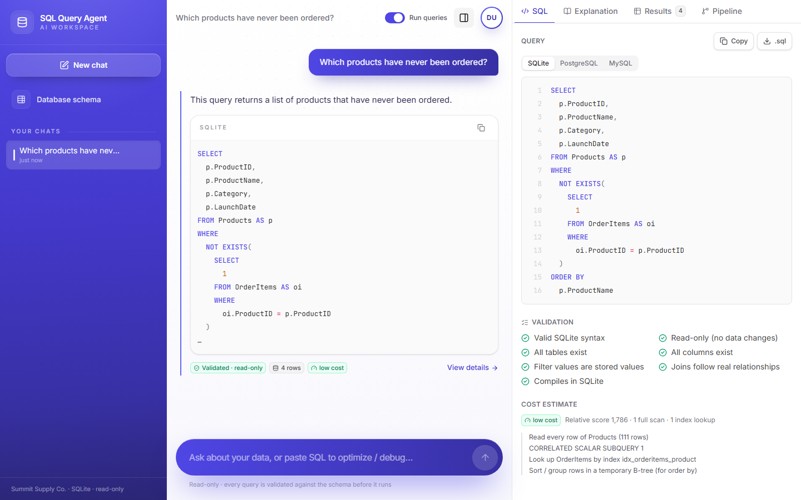
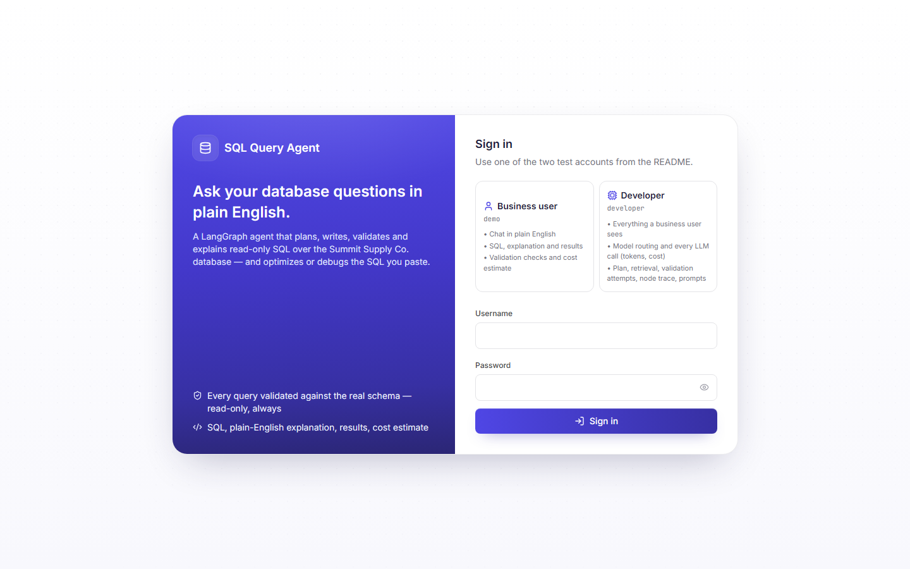
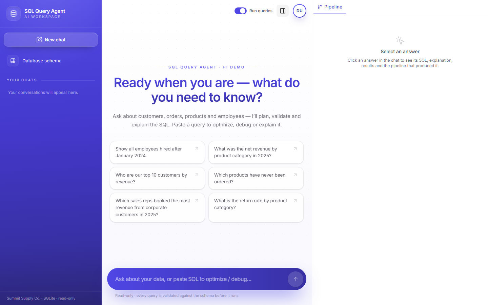
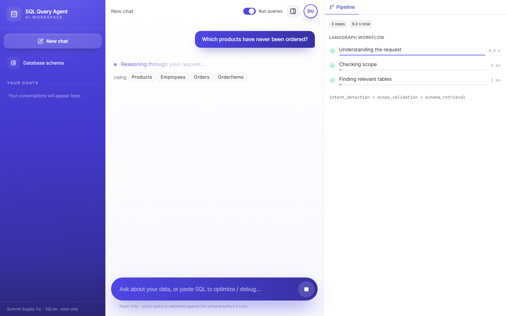
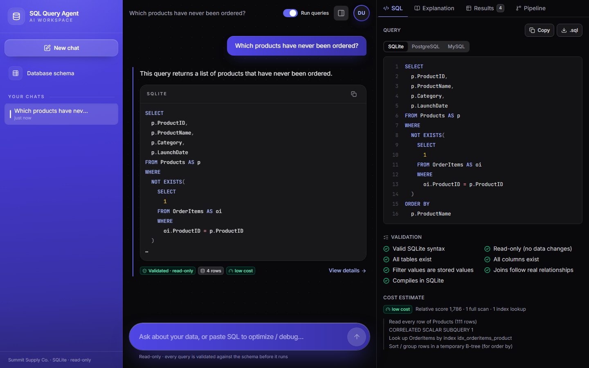
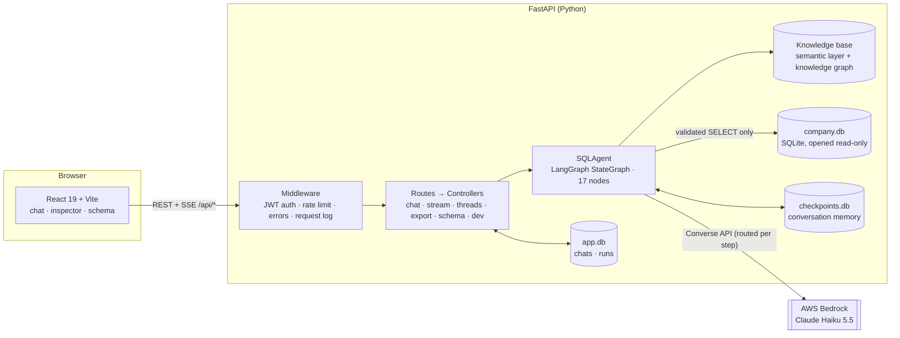
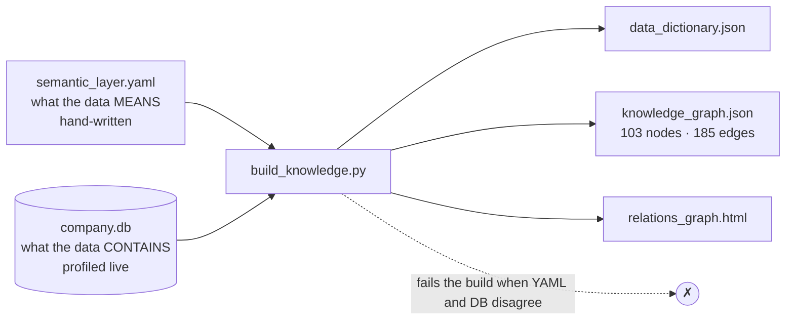

# SQL Query AI Agent

An AI assistant that turns plain-English questions into **validated, read-only SQL**. It also explains,
optimizes and debugs queries, holds a multi-turn conversation, and refuses anything outside its scope. It is
built as a **LangGraph** state machine with a **FastAPI** backend, a **React** chat UI, and **Claude Haiku 5.5 on
AWS Bedrock**.

> **Live demo:** _link added after deployment_

### Test logins

| Account | Username | Password | What it shows |
|---|---|---|---|
| Normal user | `demo` | `demo-sql-2026` | The end-user experience: chat, SQL, explanation, results, CSV, cost, validation, pipeline summary |
| Developer | `developer` | `dev-sql-2026` | Everything above, plus the **Dev** and **Runs** tabs (trace, every LLM call with tokens, cost and time, run history), the prompt library and the knowledge graph |

Both logins are defined in `backend/.env` (`AUTH_NORMAL_*`, `AUTH_DEV_*`) and can be changed there.



---

## Contents

1. [What it does](#what-it-does)
2. [Assignment coverage](#assignment-coverage)
3. [Quick start](#quick-start)
4. [Using the app](#using-the-app)
5. [Architecture at a glance](#architecture-at-a-glance)
6. [The LangGraph pipeline](#the-langgraph-pipeline)
7. [Knowledge graph and grounding](#knowledge-graph-and-grounding)
8. [Safety and guardrails](#safety-and-guardrails)
9. [LLM layer: Bedrock, model routing, structured outputs](#llm-layer-bedrock-model-routing-structured-outputs)
10. [Sample database](#sample-database)
11. [API reference](#api-reference)
12. [Frontend](#frontend)
13. [Configuration](#configuration)
14. [Project structure](#project-structure)
15. [Testing and quality](#testing-and-quality)
16. [Documentation index](#documentation-index)
17. [Limitations and next steps](#limitations-and-next-steps)

---

## What it does

| You ask | The agent |
|---|---|
| "Show all employees hired after January 2024." | Writes the SQL, validates it, runs it (135 rows) and explains it in plain English |
| "Show all customers." → "Only those from California." | Treats the second message as a follow-up and **edits the previous query** (`WHERE c.State = 'CA'`, 343 rows) |
| "Which sales reps generated the most net revenue from West Coast customers in 2024? Top 5." | Plans a 4-table join, applies the business definition of *net revenue*, maps *West Coast* to `IN ('CA','OR','WA')` |
| "Optimize this query: `SELECT * FROM Orders WHERE …`" | Rewrites it and accepts the rewrite **only if it returns identical rows**, with cost before/after and index advice |
| "Why is this query failing? `SELECT … FROM Customer WHERE State = 'California'`" | Lists each issue and why it is wrong, then returns a corrected query that has been validated and executed |
| "Explain this query: …" | Gives a step-by-step plain-English explanation |
| "What does the Segment column mean?" | Answers from the knowledge base documentation |
| "Who won the FIFA World Cup?" | *"I'm designed to assist only with SQL and database-related tasks. Please ask a question related to the provided database schema."* |
| "Delete all cancelled orders" | Refuses, and offers a read-only `SELECT` that shows the affected rows instead |

Every answer comes with the SQL (with syntax highlighting, copy and download), the explanation, the results (with a
full CSV export), a validation checklist, a cost estimate, PostgreSQL/MySQL versions of the query, and three
grounded **"Dive deeper"** follow-up questions.

## Assignment coverage

### Core requirements

| Requirement | Status | Where |
|---|---|---|
| Natural language → SQL | ✅ | `query_planner` → `plan_grounding` → `sql_generation` |
| SQL validation (syntax, tables, columns, read-only) | ✅ | Deterministic [`SQLValidator`](backend/agent/guardrails/sql_validator.py) (sqlglot AST + SQLite compile) |
| Block DELETE / UPDATE / INSERT / DROP / ALTER / TRUNCATE | ✅ | Four independent layers, see [Safety](#safety-and-guardrails) |
| Query explanation | ✅ | `generate_explanation` (streamed) |
| Query optimization | ✅ | `sql_optimization`, with a result-equivalence check |
| Query debugging | ✅ | `sql_debugging` + validator findings |
| Conversation context / follow-ups | ✅ | LangGraph checkpointer, previous plan and SQL are edited |
| Out-of-scope refusal (exact wording) | ✅ | `scope_validation` |
| LangGraph orchestration | ✅ | 17-node `StateGraph` with a repair loop, parallel fan-out and memory |
| Chat UI, SQL panel, explanation panel, history, loading state, errors, copy | ✅ | React app |

### Bonus features

| Bonus | Status | Notes |
|---|---|---|
| Query execution against a sample DB | ✅ | Read-only SQLite, 5 s timeout, 500-row preview + true total count |
| Follow-up suggestions | ✅ | "Dive deeper": drill-down / refine / related, checked against the schema |
| Query cost estimation | ✅ | From SQLite's `EXPLAIN QUERY PLAN`: full scans, index use, temp sorts, index DDL advice |
| SQL syntax highlighting | ✅ | Custom highlighter, no heavy editor dependency |
| Multiple SQL dialects | ✅ | SQLite (executed) plus PostgreSQL and MySQL versions via sqlglot |
| CSV export / download SQL | ✅ | Server-side CSV re-runs the validated SQL (up to 50,000 rows); `.sql` download |
| Prompt injection protection | ✅ | Deterministic input guard **before any LLM call**, plus prompt-level rules and output validation |
| Dark mode, streaming responses | ✅ | Theme toggle; SSE progress per node + token-streamed explanation |
| Unit tests | ✅ | 137 tests, no network needed (scripted LLM) |
| Docker / deployment | ⏳ | Next step |

### Deliverables

| Deliverable | Where |
|---|---|
| Source code | `backend/`, `frontend/` |
| README | this file |
| Architecture diagram | [docs/architecture.md](docs/architecture.md) |
| LangGraph workflow explanation | [docs/workflow.md](docs/workflow.md) |
| Prompts used | [docs/prompts.md](docs/prompts.md) (generated from the code) |
| Sample database schema | [docs/database.md](docs/database.md) and [backend/data/schema.sql](backend/data/schema.sql) |
| Assumptions | [docs/assumptions.md](docs/assumptions.md) |
| PDF copies of every document | `docs/pdf/` |
| Deployed link | Linked at the top once available |

## Quick start

### Prerequisites

- Python **3.11+** (developed on 3.14)
- Node.js **20+**
- An **AWS Bedrock API key** (bearer token) with access to Claude Haiku 5.5 in `us-west-2`

### 1. Backend

```bash
cd backend
python -m venv .venv
# Windows: .venv\Scripts\activate    macOS/Linux: source .venv/bin/activate
pip install -e ".[dev]"

cp .env.example .env
# Fill in AWS_BEARER_TOKEN_BEDROCK, the two test-account passwords and AUTH_SECRET

python scripts/check_llm.py          # confirms Bedrock answers on both model tiers
uvicorn main:app --reload --port 8000
```

The sample database (`data/company.db`) and the knowledge base (`knowledge_base/*.json`) are committed, so no
build step is needed. To regenerate them:

```bash
pip install -e ".[data]"
python scripts/generate_data.py --xlsx   # deterministic synthetic data (+ Excel copy)
python scripts/build_knowledge.py        # data dictionary, knowledge graph, relations_graph.html
python scripts/generate_docs.py          # docs/prompts.md, docs/database.md, graph in docs/workflow.md

pip install -e ".[docs]" && python -m playwright install chromium
python scripts/export_docs_pdf.py        # README + docs/*.md → docs/pdf/*.pdf
```

### 2. Frontend

```bash
cd frontend
npm install
cp .env.example .env
npm run dev                           # http://localhost:5173 (proxies /api to :8000)
```

### 3. Single-process mode (as deployed)

```bash
cd frontend && npm run build          # writes frontend/dist
cd ../backend && uvicorn main:app --port 8000
# http://localhost:8000 serves the UI and the API
```

### 4. Terminal client (optional)

```bash
cd backend
python scripts/ask.py "Show all employees hired after January 2024."
python scripts/ask.py --thread demo "Show all customers." "Only those from California."
python scripts/ask.py --dev "Top 5 customers by revenue"     # also prints the trace and every LLM call
```

## Using the app

| | |
|---|---|
|  |  |
| **Login.** Two test accounts, defined in `backend/.env` | **Welcome.** Example questions and a schema browser |
|  |  |
| **Streaming.** A live caption follows the graph ("Planning the query…", "Validating the SQL…") | **Dark mode** |

**Two roles.** Both accounts use the same agent. The role only changes what the API returns:

| | `demo` (normal) | `developer` |
|---|---|---|
| Chat, SQL, explanation, results, CSV, cost, validation checklist, pipeline summary | ✅ | ✅ |
| **Dev** tab: intent, retrieval, plan, grounding, every validation attempt, node trace, every LLM call (model, routing reason, tokens, cost, latency), usage totals table | – | ✅ |
| **Runs** tab: history of past runs with tokens, cost and timing | – | ✅ |
| Prompt library and knowledge-graph viewer | – | ✅ |

The role is enforced on the server (`/api/dev/*` returns 403 for the normal account, and the response's `dev`
section is stripped). It is not just hidden in the UI.

## Architecture at a glance



The guiding idea: **the LLM decides what to ask; deterministic code decides whether it is correct and safe.**
Anything that can be checked without a model is: names, stored values, joins, read-only-ness, cost and result
equivalence. The model only sees a schema slice that has been grounded against the real data, and every SQL it
writes goes through the validator before it can reach the database.

More detail, including sequence diagrams, storage and security layers: **[docs/architecture.md](docs/architecture.md)**.

## The LangGraph pipeline

```text
receive_request ─► intent_detection ─► scope_validation ─┬─► return_response    (refusal)
                                                         ├─► ask_clarification  (optimize/debug/explain without SQL)
                                                         ├─► schema_answer      (questions about the database)
                                                         └─► schema_retrieval
schema_retrieval ─┬─► query_planner ─► plan_grounding ─┬─► ask_clarification   (unknown field / value / ambiguity)
                  │                                    └─► sql_generation ─► sql_validation
                  └─► sql_validation                    (user-supplied SQL)

sql_validation ─┬─ valid ──► [sql_debugging] ─► sql_optimization ─► execute_query ─┬─► generate_explanation ┐ parallel
                │                                                                  └─► suggest_follow_ups   ┘
                ├─ invalid, user's SQL    ─► sql_debugging ─► sql_validation
                ├─ invalid, attempts left ─► sql_repair    ─► sql_validation       (self-correction, max 3)
                └─ invalid, budget spent  ─► return_response
every terminal node ─► return_response ─► END
```

| Feature | How |
|---|---|
| One file per node | `agent/<area>/<node_name>.py`, e.g. [`exec/sql_generation.py`](backend/agent/exec/sql_generation.py) |
| All branching in one place | [`supervisor/routing.py`](backend/agent/supervisor/routing.py) |
| Self-correction | `sql_validation ⇄ sql_repair` cycle; the repair prompt gets each finding's code, message and fix hint |
| Parallel fan-out | `generate_explanation` ∥ `suggest_follow_ups` in one superstep; an append reducer merges their trace/LLM records |
| Memory | Checkpointer keyed by `thread_id` (SQLite in production). Follow-ups edit the **previous plan** and **previous SQL** |
| Streaming | `graph.stream(stream_mode=["updates","messages"])` → one SSE event per node + explanation tokens |
| Resilience | `traced()` wraps every node: timing, trace event, and any exception becomes a clean `failure` |

Node-by-node description, the state schema, routing table and walkthroughs: **[docs/workflow.md](docs/workflow.md)**.

## Knowledge graph and grounding

Generating SQL from table names alone fails on real data. "California" is stored as `CA`, "revenue" excludes
cancelled orders, and "sales rep" means `Orders.EmployeeID`. The agent therefore works from a knowledge base,
built the same way as in the intelligence-assistant:



- **Graph:** 5 tables, 57 columns, 21 metrics and 20 glossary terms as nodes. Edges are `has_column`,
  `references`, `joins_to` and `uses`. It also holds every join path, validated metric SQL, and indexes of stored
  values and schema terms.
- **Retrieval swarm** ([`retrieval/swarm.py`](backend/agent/retrieval/swarm.py)): several retrievers run in
  parallel over schema terms, stored values, metrics and glossary, similar worked examples (14 Q→SQL pairs in
  `examples.yaml`), tables in pasted SQL, and the previous turn's tables. FK bridge tables are added automatically.
- **Phrase matching** ([`knowledge/kb_resolver.py`](backend/agent/knowledge/kb_resolver.py)): it takes the longest
  non-overlapping match ("west coast" beats "west"). US state codes match only in upper case, so "in" is not
  Indiana. Table words and stored values are told apart ("products" the table vs the *Product* department).
- **Plan grounding** ([`planner/plan_grounding.py`](backend/agent/planner/plan_grounding.py)): the planner writes
  values *as the user said them*. Grounding snaps names to the real schema, maps values to stored values
  (`California` → `'CA'`, regions → `IN` lists, product names through a database `LIKE` search), attaches metric
  definitions, and computes the minimal FK join tree (an exact Steiner tree over the 5 tables). It also scores
  complexity. Anything it cannot resolve becomes a **clarifying question** instead of a guess.

## Safety and guardrails

Write protection is layered, so no single failure can modify data:

| Layer | Where | What it stops |
|---|---|---|
| 1. Input guard | [`guardrails/input_guard.py`](backend/agent/guardrails/input_guard.py), before any LLM call | Prompt injection patterns (override instructions, reveal prompt, role hijack, jailbreak modes, fake delimiters), pasted write SQL, empty or over-long input |
| 2. Intent + scope | `intent_detection` → `scope_validation` | Destructive and out-of-scope requests are refused deterministically |
| 3. SQL validator | [`guardrails/sql_validator.py`](backend/agent/guardrails/sql_validator.py) | Anything that is not one read-only `SELECT`, plus unknown tables/columns/values, joins not backed by a foreign key, SQL SQLite cannot compile, and SQL that ignores the plan's filters |
| 4. Read-only database | [`exec/sqlite_runner.py`](backend/agent/exec/sqlite_runner.py) | `mode=ro` URI, `PRAGMA query_only`, an authorizer that allows only SELECT/READ/FUNCTION (and blocks `load_extension`, `readfile`, …), statement timeout, row cap |
| Prompts | `SECURITY_RULES` in every prompt | User text is wrapped as data, never as instructions |
| API | [`middleware/`](backend/middleware/) | JWT auth, per-IP rate limits (6/min, 60/day), login throttling, chats isolated per user and browser, generic 500s |

## LLM layer: Bedrock, model routing, structured outputs

- **Provider:** AWS Bedrock Converse API through `langchain-aws` (`ChatBedrockConverse`), region `us-west-2`,
  authenticated with a Bedrock API key (`AWS_BEARER_TOKEN_BEDROCK`). This is the same setup as the
  intelligence-assistant. Default model: **Claude Haiku 5.5** (`us.anthropic.claude-haiku-5-5`) for both tiers.
- **Model routing** ([`llm_client.py`](backend/agent/llm_client.py)): nodes request a model by *pipeline step*,
  never by name. The order of precedence is:
  1. a `MODEL_ROUTES` pin from `.env`;
  2. retries (attempt > 1), which always escalate to the main model;
  3. `sql_generation`, which is routed by plan complexity (fast for simple single-table plans, main otherwise);
  4. otherwise, the step's default tier.

  Swapping a tier or a single step to Sonnet is a one-line `.env` change.
- **Structured outputs:** every non-prose step returns a Pydantic model ([`llm_schemas.py`](backend/agent/llm_schemas.py))
  through Bedrock's native JSON-schema mode. A reply that does not parse is retried once with tool calling. The
  code never uses regexes on model output.
- **Observability:** every call is recorded as an `LLMCall` (step, model, routing reason, latency, input and output
  tokens, USD cost). These records drive the developer view, the usage table and the run history.
- **Typical cost:** a full question takes 5 LLM calls, about 16k input / 1.5k output tokens, and **≈ $0.0025**.
  A refusal takes 1 call and ≈ $0.0002.

| Step | Default tier | Prompt |
|---|---|---|
| intent_detection | fast | [prompts.md#intent_detection](docs/prompts.md#intent_detection) |
| query_planner | main | [prompts.md#query_planner](docs/prompts.md#query_planner) |
| sql_generation | by complexity | [prompts.md#sql_generation](docs/prompts.md#sql_generation) |
| sql_repair / sql_debugging / sql_optimization | main | [prompts.md](docs/prompts.md) |
| generate_explanation / suggest_follow_ups / schema_answer | fast | [prompts.md](docs/prompts.md) |

## Sample database

**Summit Supply Co.**, a fictional US omnichannel retailer, stored in SQLite with 5 tables and deterministic
synthetic data (fixed seed):

| Table | Rows | Holds |
|---|---|---|
| `Employees` | 333 | Workforce, with a self-referencing `ManagerID` hierarchy |
| `Customers` | 3,000 | Consumers and businesses, with an account manager |
| `Products` | 111 | Catalog with price, cost, stock, launch and discontinuation |
| `Orders` | 16,613 | Order header: customer, sales rep, status, payment, shipping |
| `OrderItems` | 30,449 | Order lines at the historical price and discount |

The data is shaped to make questions interesting: seasonality, churn, never-ordered customers and never-sold
products, status driven by order age, overdue invoices. The full schema, ER diagram, every column's meaning and
values, metrics and glossary are in **[docs/database.md](docs/database.md)**.

## API reference

All routes are under `/api`. Every route except `/auth/login`, `/auth/accounts` and `/health` needs
`Authorization: Bearer <token>`. Chat routes also need `X-Client-Id`, which the browser generates.

| Method | Path | Purpose |
|---|---|---|
| POST | `/auth/login` | `{username, password}` → `{token, expires_at, user}` |
| GET | `/auth/me` · `/auth/accounts` | Current user · the two test accounts (names and roles only) |
| POST | `/chat` | `{question, thread_id?, execute?}` → full response |
| POST | `/chat/stream` | Same, as Server-Sent Events: `start`, `node` (×N), `token` (×N), `response` |
| GET / PATCH / DELETE | `/threads`, `/threads/{id}` | List, load, rename, delete chats |
| GET | `/export/{request_id}.csv` | Full CSV of an answer (re-runs its validated SQL, ≤ 50,000 rows) |
| GET | `/schema` · `/schema/graph` | Schema browser data · knowledge graph |
| GET | `/dev/llm` · `/dev/prompts` · `/dev/knowledge-graph` · `/dev/runs` | Developer only |
| GET | `/health` | Database, model and auth configuration status |

A response's `type` is one of `sql`, `answer`, `clarification`, `refusal` or `error`. An `sql` response contains
`sql`, `explanation`, `results`, `cost`, `validation`, `dialects`, `assumptions`, `mappings`, `suggestions` and
`pipeline`, plus `dev` for the developer account.

## Frontend

React 19 + TypeScript 5.9 + Vite 8 + Tailwind CSS 4. The look and feel follows the intelligence-assistant
(gradient sidebar, pill composer, shimmer waiting state, "Dive deeper"), in an indigo theme.

```text
frontend/src/
├── api/          client.ts (typed REST client), sse.ts (stream parser), types.ts (API contract)
├── context/      AuthContext (session, role), SettingsContext (theme, execute toggle)
├── hooks/        useChat (streaming turn state), useThreads, useSchema, useMediaQuery
├── lib/          sqlHighlight, download, format, pipeline (node → caption), storage, cn
├── types/        chat.ts (UI message model)
└── components/
    ├── ui/         Button, IconButton, Badge, Tabs, Switch, Spinner, Modal/Drawer, Toast, CopyButton, Markdown, Section
    ├── layout/     AppShell, Sidebar, ThreadItem, ProfileMenu
    ├── chat/       ChatView, MessageList, UserMessage, AssistantMessage, StreamingProgress, Composer, EmptyState, DiveDeeper
    ├── inspector/  Inspector + SqlTab, ExplanationTab, ResultsTab, PipelineTab, DevTab, RunsTab
    ├── sql/        SqlCode, ValidationChecklist, CostCard
    ├── schema/     SchemaDrawer
    ├── dev/        PromptsDialog
    └── auth/       LoginPage
```

Components are presentational. Data access lives in `api/` and `hooks/`, and cross-cutting state lives in
`context/`. Only `VITE_*` variables reach the browser, so the frontend `.env` never holds secrets.

## Configuration

Backend settings come from `backend/.env` (see [`backend/.env.example`](backend/.env.example) and
[`utils/config.py`](backend/utils/config.py)):

| Group | Variables |
|---|---|
| LLM (Bedrock) | `AWS_BEARER_TOKEN_BEDROCK`, `AWS_REGION`, `LLM_MODEL_FAST`, `LLM_MODEL_MAIN`, `LLM_MAX_TOKENS`, `LLM_INPUT_COST_PER_M`, `LLM_OUTPUT_COST_PER_M` |
| Routing | `MODEL_ROUTES` (JSON, e.g. `{"sql_generation": "us.anthropic.claude-sonnet-5-5"}`), `SQL_FAST_MODEL_MAX_COMPLEXITY` |
| Accounts | `AUTH_NORMAL_USERNAME/PASSWORD/DISPLAY_NAME`, `AUTH_DEV_USERNAME/PASSWORD/DISPLAY_NAME`, `AUTH_SECRET`, `AUTH_TOKEN_TTL_HOURS` |
| Guardrails | `MAX_RESULT_ROWS` (500), `QUERY_TIMEOUT_S` (5), `MAX_SQL_FIX_ATTEMPTS` (3), `EXPORT_MAX_ROWS` (50,000) |
| Features | `SUGGESTIONS_ENABLED` |
| API protection | `RATE_LIMIT_PER_MINUTE` (6), `RATE_LIMIT_PER_DAY` (60), `LOGIN_ATTEMPTS_PER_MINUTE` (10) |

Frontend settings (`frontend/.env`): `VITE_API_BASE_URL` (empty when served by the backend) and
`VITE_DEV_PROXY_TARGET`.

## Project structure

```text
.
├── backend/
│   ├── main.py                    FastAPI app: lifespan, CORS, error handlers, request log, SPA serving
│   ├── agent/
│   │   ├── supervisor/            graph build (supervisor.py), state, routing, traced() wrapper, dependencies
│   │   ├── intent/                receive_request, intent_detection, scope_validation
│   │   ├── retrieval/             schema_retrieval + the retrieval swarm
│   │   ├── planner/               query_planner, plan_grounding
│   │   ├── exec/                  sql_generation, sql_repair, sql_debugging, sql_optimization, execute_query,
│   │   │                          sqlite_runner (read-only DB), cost_estimator
│   │   ├── guardrails/            input_guard, sql_validator, sql_validation
│   │   ├── narrative/             generate_explanation, suggest_follow_ups, ask_clarification, schema_answer, return_response
│   │   ├── knowledge/             kb_resolver (phrase matching, join planning), us_geography
│   │   ├── llm_client.py          Bedrock gateway, model router, call records
│   │   └── llm_schemas.py         Pydantic contracts for every structured LLM step
│   ├── prompt_library/            one versioned module per LLM node + shared rule blocks
│   ├── routes/ controllers/ middleware/   HTTP layer (thin routes → controllers; auth, rate limit, errors)
│   ├── utils/                     settings, chat/run store
│   ├── knowledge_base/            semantic_layer.yaml, examples.yaml, generated dictionary + graph
│   ├── data/                      schema.sql, company.db, company_sample.xlsx
│   ├── scripts/                   generate_data, build_knowledge, generate_docs, check_llm, ask, export_docs_pdf
│   └── tests/                     pytest suite + ScriptedLLM test double
├── frontend/                      React app (see Frontend)
└── docs/                          architecture, workflow, prompts, database, assumptions, images, pdf/
```

## Testing and quality

```bash
cd backend
pytest -q              # 137 tests, a few seconds, no network
ruff check .
cd ../frontend
npm run typecheck
```

| Suite | Covers |
|---|---|
| `test_data` | Database shape, FK integrity, realism properties |
| `test_knowledge` | Knowledge build validation, phrase matching, value lookup, join planning |
| `test_sql_validator` | Each validator check, with positive and negative cases |
| `test_guardrails` | Prompt injection, write-SQL detection, read-only runner, authorizer |
| `test_planning` | Grounding, model routing, cost estimation, every worked example validates and runs |
| `test_graph` | The full LangGraph on a scripted LLM: every route, repair loop, follow-ups, refusals, failures |
| `test_api` | Auth, roles, rate limits, ownership, streaming, export |

The graph tests use [`ScriptedLLM`](backend/tests/fakes.py), which replays queued responses per step while using
the **real** model router. They are fast and deterministic, and they also cover routing decisions. Live behaviour
on Bedrock is checked with `scripts/check_llm.py` and `scripts/ask.py`.

## Documentation index

| Document | Contents |
|---|---|
| [docs/architecture.md](docs/architecture.md) | System diagram, request sequence, knowledge pipeline, security, storage, observability |
| [docs/workflow.md](docs/workflow.md) | The LangGraph: compiled graph, state, every node, routing rules, walkthroughs |
| [docs/prompts.md](docs/prompts.md) | Every prompt in full, with its node, version, model tier and output contract |
| [docs/database.md](docs/database.md) | Schema, ER diagram, column meanings and values, metrics, glossary |
| [docs/assumptions.md](docs/assumptions.md) | Assumptions and design decisions |
| `docs/pdf/` | PDF versions of all of the above and this README |

## Limitations and next steps

- **SQLite only for execution.** PostgreSQL and MySQL versions are translated (sqlglot) but not executed.
  Pointing the runner at another engine means swapping `ReadOnlyDatabase` and the `EXPLAIN`-based cost estimator.
- **One database per deployment.** The knowledge base is built per schema; a new database needs its semantic
  layer written.
- **In-memory rate limiter.** Fine for a single instance; use Redis for horizontal scaling.
- **No accuracy benchmark.** A golden-question evaluation set was deliberately left out of scope for now.
- **Docker and deployment** are the next step.
