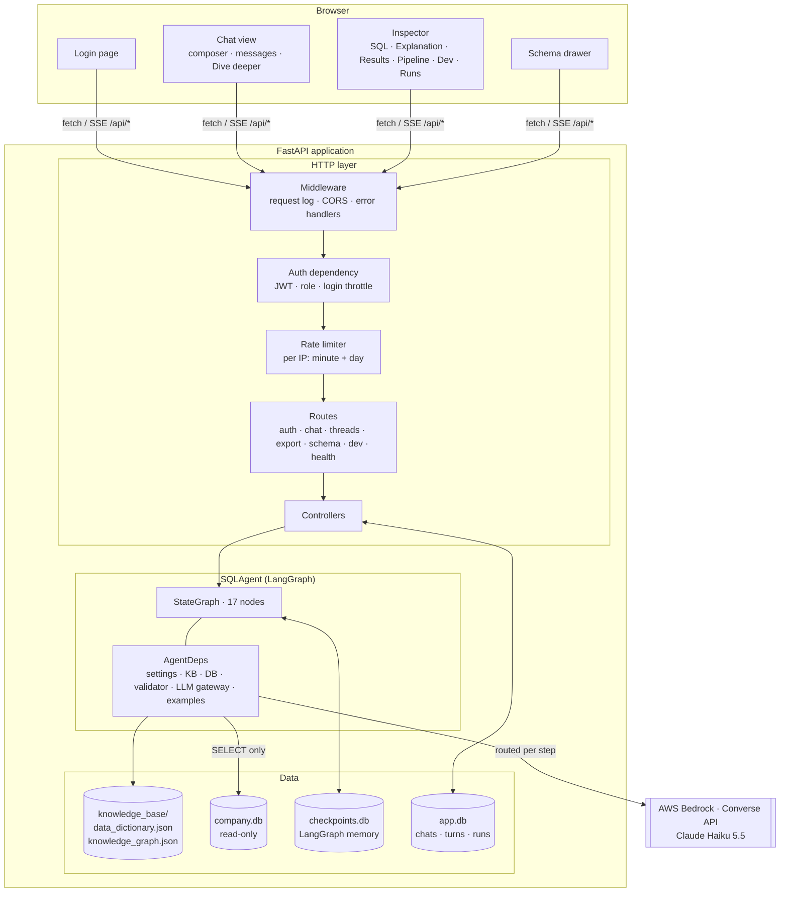
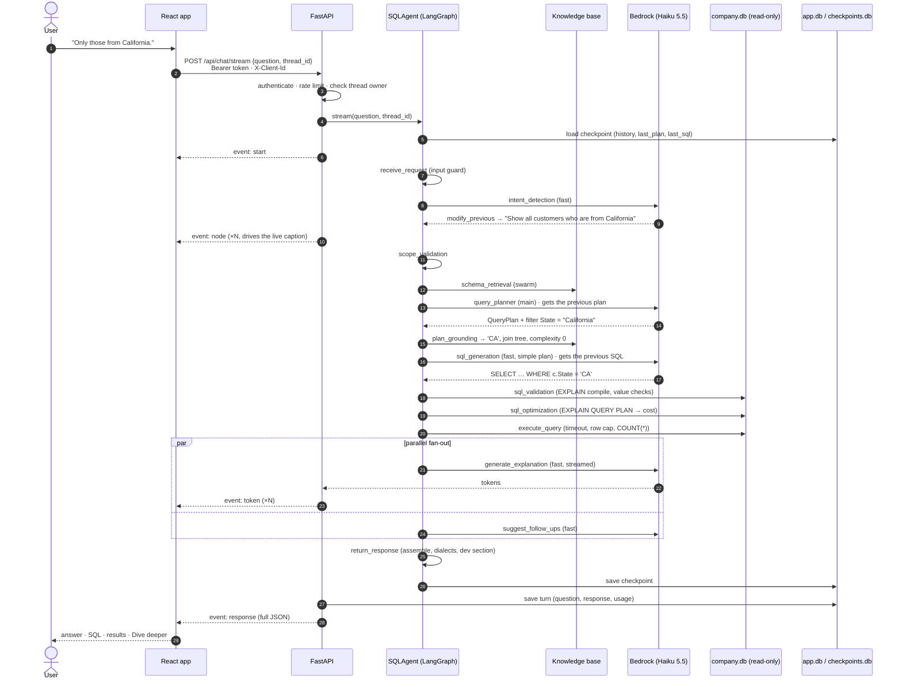
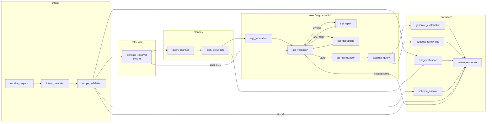
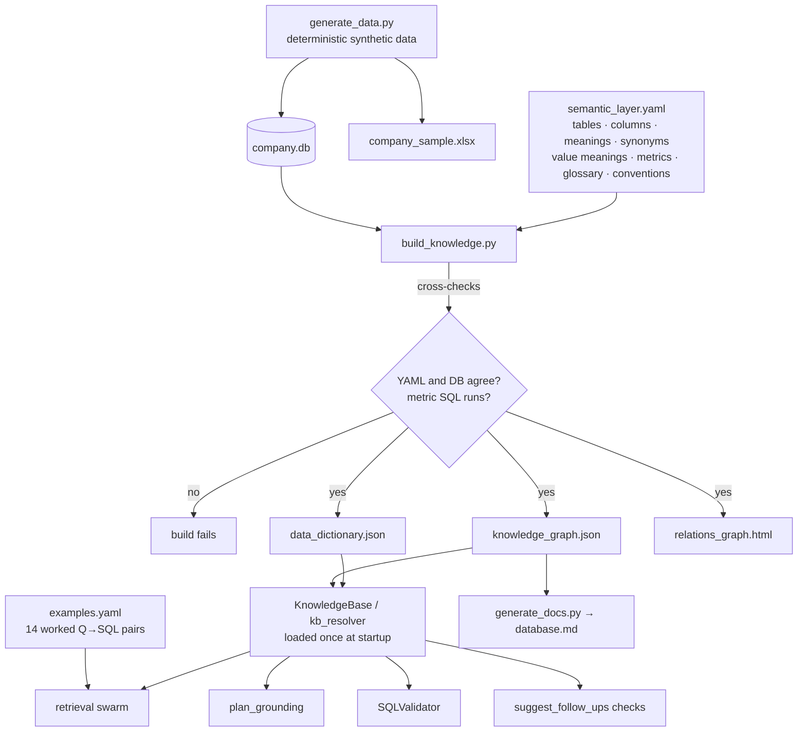
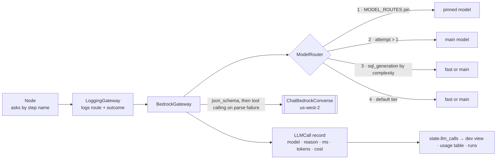
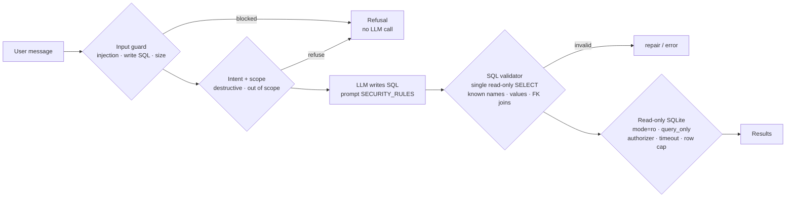
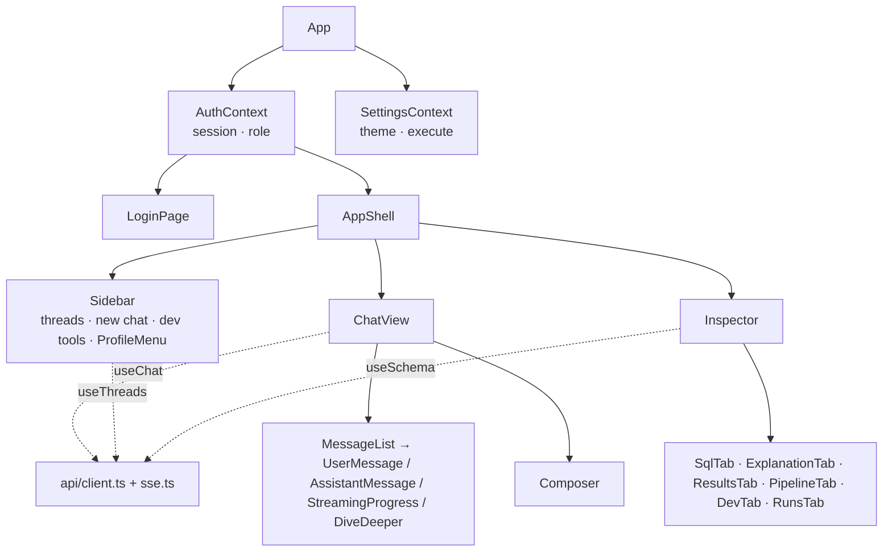

# Architecture

This document describes how the SQL Query AI Agent is put together: the components, how a request flows through
them, how the knowledge base is built, the security model, where state is stored, and how the system can be
observed. The LangGraph pipeline itself is covered node by node in [workflow.md](workflow.md).

- [System overview](#system-overview)
- [Design principles](#design-principles)
- [Request lifecycle](#request-lifecycle)
- [Backend layers](#backend-layers)
- [The agent](#the-agent)
- [Knowledge pipeline](#knowledge-pipeline)
- [LLM layer](#llm-layer)
- [Security model](#security-model)
- [Authentication and roles](#authentication-and-roles)
- [State and storage](#state-and-storage)
- [Observability](#observability)
- [Frontend architecture](#frontend-architecture)
- [Deployment topology](#deployment-topology)

---

## System overview



| Component | Technology | Responsibility |
|---|---|---|
| Frontend | React 19, TypeScript, Vite, Tailwind | Chat UX, streaming progress, inspector panels, downloads, theme |
| HTTP layer | FastAPI, Pydantic, PyJWT | Auth, roles, rate limits, validation of request bodies, SSE, error shaping |
| Agent | LangGraph `StateGraph` | Orchestrates the 17 steps, memory, self-correction, parallel branches |
| Knowledge base | YAML + generated JSON | Meaning of every table, column, value, metric and term; join paths |
| Validator | sqlglot + SQLite | Deterministic correctness and safety checks on every SQL |
| Database | SQLite (read-only connection) | Sample data for execution, cost estimation and value lookups |
| LLM | AWS Bedrock, `langchain-aws` | Intent, planning, SQL writing/repair, explanation, suggestions |

## Design principles

1. **The model proposes, deterministic code disposes.** The LLM classifies, plans and writes, while code verifies
   names, values, joins, read-only-ness and result equivalence. The model is never the last line of defence.
2. **Plan before SQL.** A structured `QueryPlan` is easier to check and ground than raw SQL. Grounding turns the
   user's words into the database's words before any SQL is written.
3. **Ask rather than guess.** An unknown field, a value that does not exist, or a genuinely ambiguous join path
   produces one focused clarifying question.
4. **Fail closed, degrade gracefully.** Safety checks block on doubt. Optional steps (explanation, suggestions)
   fall back to deterministic output when the model fails.
5. **Everything observable.** Every node and every LLM call is recorded with timing, and every call also records
   its model, tokens and cost.
6. **Testable without a network.** The LLM sits behind a protocol, and the test suite drives the real graph
   with a scripted model.

## Request lifecycle

A streamed question, end to end:



`POST /api/chat` runs the same graph and returns only the final JSON.

## Backend layers

```text
routes/        HTTP shape only: path, method, dependencies (auth, rate limit), response model
controllers/   request handling: ownership checks, calling the agent, persisting turns, shaping output per role
middleware/    cross-cutting: JWT auth and roles, rate limiting, error handlers
agent/         the LangGraph agent (no HTTP knowledge at all)
utils/         settings (pydantic-settings) and the chat/run store
```

The agent has no dependency on FastAPI. It is used the same way by the API, by the terminal client
(`scripts/ask.py`) and by the tests. Settings are read once from `backend/.env` into a typed `Settings` object, and
every component receives what it needs through `AgentDeps` (dependency injection). Nothing reads environment
variables directly.

## The agent



The folder layout follows the intelligence-assistant (`supervisor/`, `planner/`, `exec/`, `retrieval/`, …), with one
file per LangGraph node, named after the node. `supervisor/` holds the graph assembly, state schema, routing
functions, the `traced()` wrapper and dependency wiring. The full node reference is in [workflow.md](workflow.md).

## Knowledge pipeline



**What the graph holds:** 5 table nodes, 57 column nodes, 21 metric nodes and 20 glossary-term nodes, with
`has_column`, `references`, `joins_to` and `uses` edges. Alongside them are every join path between tables,
validated metric SQL, state groups (regions → state codes), and two lookup indexes: stored values → columns and
schema terms/synonyms → tables/columns.

**Who uses it:**

| Consumer | Uses |
|---|---|
| Retrieval swarm | Term index, value index, metric/glossary matching, examples, FK bridge tables |
| Plan grounding | Name snapping, value mapping, state groups, metric definitions, join tree (exact Steiner tree) |
| SQL validator | Known tables/columns, enumerated values with hints, valid FK join pairs |
| Follow-up suggester | Rejects suggestions that mention unknown fields |
| Schema answers / schema drawer | Column meanings, values, relationships |

## LLM layer



- **Gateway protocol.** `LLMGateway` has two methods: `structured(step, messages, schema)` and
  `text(step, messages)`. Production uses `BedrockGateway`, and tests use `ScriptedLLM`. Both are wrapped by
  `LoggingGateway`.
- **Bedrock specifics.** Requests go through the Converse API with a bearer-token API key and a botocore config
  (connect and read timeouts, standard retry mode with backoff for throttling). No sampling parameters are sent,
  and text is read from content blocks via `.text`.
- **Failure mapping.** A failed call raises `LLMCallFailed`, which carries the call record, so failures still
  appear in the trace and the cost totals. The `traced()` wrapper classifies the failure (`llm_quota`,
  `llm_rate_limited`, `llm_error`, `llm_not_configured`), and `return_response` turns that into a user-friendly
  message.

## Security model



| Threat | Mitigations |
|---|---|
| Data modification | Four independent layers (above). Even a validator bug cannot write: the connection itself is read-only and the authorizer denies everything except SELECT/READ/FUNCTION |
| Prompt injection | Deterministic input guard before the first LLM call. User text is fenced as data in every prompt. Model output is schema-validated and never executed without the validator |
| Data exfiltration via SQL functions | Authorizer blocks `load_extension`, `readfile`, `writefile`, `edit`, `fts3_tokenizer` |
| Expensive queries | 5 s statement timeout (progress handler), 500-row preview, 50,000-row export cap, cost estimate shown |
| Abuse / cost blow-up | Per-IP sliding-window rate limits (6/min, 60/day), login throttling (10/min), question length cap |
| Cross-user access | Chats are owned by `username:client_id`; every thread, export and run lookup checks ownership |
| Internal details leaking | Unhandled errors return a generic 500 (details only in the server log). The `dev` section and `/api/dev/*` are only served to the developer role |
| Secrets | Only in `backend/.env` (gitignored). The frontend `.env` holds no secrets. The Bedrock key is passed to botocore through its environment variable and is never logged |

## Authentication and roles

- Two accounts are defined in `backend/.env`: a **normal** account and a **developer** account.
- `POST /api/auth/login` checks the credentials (constant-time comparison) and returns an HS256 JWT signed with
  `AUTH_SECRET`, valid for `AUTH_TOKEN_TTL_HOURS` (12 by default). The token carries the username and role.
- The `current_user` dependency validates the token on every protected route, and `require_dev` guards
  `/api/dev/*`.
- Responses are shaped per audience. The same agent response is returned with or without its `dev` section,
  depending on the role.
- The browser generates a random `X-Client-Id` per installation, so two people sharing one test account do not
  see each other's chats.

## State and storage

| Store | File | Contents | Lifetime |
|---|---|---|---|
| Sample database | `backend/data/company.db` | Business data | Static (regenerated by script) |
| Knowledge base | `backend/knowledge_base/*.json` | Dictionary, graph, indexes | Static (rebuilt by script), loaded once |
| Conversation memory | `backend/data/runtime/checkpoints.db` | LangGraph checkpoints per `thread_id`: history, last plan, last SQL, pending clarification | Persistent |
| Chats and runs | `backend/data/runtime/app.db` | Thread list (owner, title), every turn's question and full response, usage | Persistent |
| Browser | `localStorage` | Session token, theme, execute toggle, client id | Per browser |

`backend/data/runtime/` is gitignored and created on startup.

## Observability

- **API request log:** method, path, status and latency for every `/api/*` call.
- **Node log:** the `traced()` wrapper logs each node's start, outcome and duration, and records a trace event
  in the state.
- **LLM log:** `LoggingGateway` logs `→ model · routing reason` before each call and
  `← served model · ms · tokens · cost` after it. Prompts and responses are logged at DEBUG level.
- **In the product:** the **Pipeline** tab shows the public step summary. The developer's **Dev** tab shows the
  full trace, every LLM call and a usage table (input/output tokens, time, cost per call and in total). The
  **Runs** tab lists past runs with their totals.
- **Health:** `GET /api/health` reports the database tables and row counts, the LLM provider and models, and
  whether the LLM and auth are configured.

## Frontend architecture



- **State:** `useChat` owns the streaming turn. It applies `node` events to the progress caption, appends
  `token` events to the explanation, and replaces the placeholder with the final `response`.
- **Contract:** `api/types.ts` mirrors the backend response, and all HTTP calls go through `api/client.ts`, which
  adds auth, the client id and error normalisation.
- **Styling:** Tailwind with CSS theme tokens. The indigo palette and the dark mode are defined once in
  `index.css`.

## Deployment topology

In production a single process serves both the built frontend (`frontend/dist`, SPA fallback) and the API, so
there is one origin and no CORS. The process needs the Bedrock key, the two account passwords and `AUTH_SECRET` as
environment variables, and a writable `data/runtime/` directory for the chats and the conversation memory.
Container packaging and hosting are the next step.
