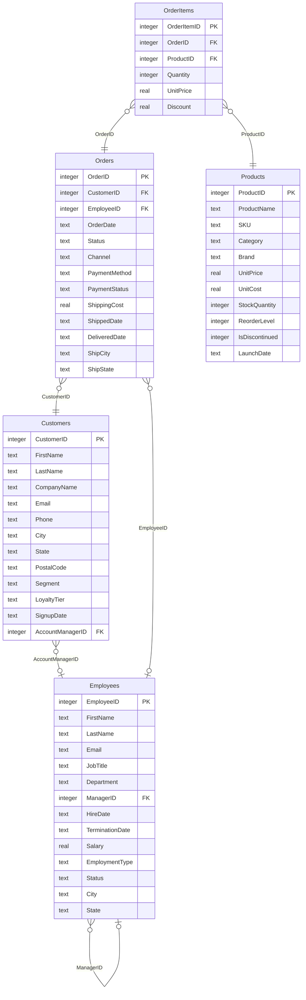

# Sample database

<!-- Generated by backend/scripts/generate_docs.py — do not edit by hand. -->

Summit Supply Co. is a US omnichannel retailer selling electronics, computers, office supplies, furniture, home & kitchen, sports, books and health products to consumers and businesses. The database covers customers, orders and order lines, the product catalog, and the workforce.

- **Engine:** SQLite (`backend/data/company.db`) · **Snapshot date:** 2026-10-20 · **DDL:** [`backend/data/schema.sql`](../backend/data/schema.sql)
- **Generated by:** [`backend/scripts/generate_data.py`](../backend/scripts/generate_data.py) (deterministic, fixed seed) · **Excel copy:** `backend/data/company_sample.xlsx`
- **Meaning of every column** comes from [`backend/knowledge_base/semantic_layer.yaml`](../backend/knowledge_base/semantic_layer.yaml); statistics and values are profiled from the live database.

## Entity–relationship diagram

## Tables

| Table | Rows | Grain | Description |
|---|---:|---|---|
| [Employees](#employees) | 333 | One row per employee (former employees are kept with Status 'Terminated'). | Everyone who works or has worked at Summit Supply Co., including the org chart. |
| [Customers](#customers) | 3,000 | One row per customer account. | People and businesses who have an account with Summit Supply Co. |
| [Products](#products) | 111 | One row per product (SKU). | The product catalog. |
| [Orders](#orders) | 16,613 | One row per order. Line items are in OrderItems. | Customer orders (one header row per order), including payment and fulfilment status. |
| [OrderItems](#orderitems) | 30,449 | One row per product per order. | Order lines — which products were bought in each order, how many, and at what price. |

### Employees

Everyone who works or has worked at Summit Supply Co., including the org chart.

| Column | Type | Key | Description | Values / range |
|---|---|---|---|---|
| `EmployeeID` | INTEGER | PK | Unique employee identifier. |  |
| `FirstName` | TEXT |  | Employee's first name. |  |
| `LastName` | TEXT |  | Employee's last name. |  |
| `Email` | TEXT |  | Work email address (unique). |  |
| `JobTitle` | TEXT |  | Current job title. | 53 distinct values |
| `Department` | TEXT |  | Department the employee belongs to. | `Sales`, `Engineering`, `Customer Support`, `Operations`, `Marketing`, `Finance`, `Product`, `Human Resources`, `Executive` |
| `ManagerID` | INTEGER | FK → Employees.EmployeeID | EmployeeID of the employee's direct manager; NULL only for the CEO. |  |
| `HireDate` | TEXT |  | Date the employee joined. | 2014-03-03 – 2026-10-17 |
| `TerminationDate` | TEXT |  | Last day of employment; NULL for current employees. | 2021-03-20 – 2026-10-17 |
| `Salary` | REAL |  | Annual base salary in USD (pro-rated for part-time staff). | 23000.0 – 340000.0 |
| `EmploymentType` | TEXT |  | Contract type. | `Full-Time`, `Part-Time`, `Contract` |
| `Status` | TEXT |  | Employment status. | `Active`, `Terminated`, `On Leave` |
| `City` | TEXT |  | City the employee works from (office city, or home city for remote staff). | 21 distinct values |
| `State` | TEXT |  | 2-letter USPS code of the state the employee works from. | 2-letter USPS state codes |

Indexes: `idx_employees_manager` (ManagerID)

### Customers

People and businesses who have an account with Summit Supply Co.

| Column | Type | Key | Description | Values / range |
|---|---|---|---|---|
| `CustomerID` | INTEGER | PK | Unique customer identifier. |  |
| `FirstName` | TEXT |  | First name of the customer (or the business's main contact). |  |
| `LastName` | TEXT |  | Last name of the customer (or the business's main contact). |  |
| `CompanyName` | TEXT |  | Business name for Small Business and Corporate customers; NULL for consumers. |  |
| `Email` | TEXT |  | Contact email address (unique). |  |
| `Phone` | TEXT |  | Contact phone number; NULL when the customer did not provide one. |  |
| `City` | TEXT |  | City of the customer's address. |  |
| `State` | TEXT |  | 2-letter USPS code of the state the customer lives in. | 2-letter USPS state codes |
| `PostalCode` | TEXT |  | ZIP code of the customer's address. |  |
| `Segment` | TEXT |  | Customer type. | `Consumer`, `Small Business`, `Corporate` |
| `LoyaltyTier` | TEXT |  | Loyalty tier based on lifetime spend on delivered orders. | `Bronze`, `Silver`, `Gold`, `Platinum` |
| `SignupDate` | TEXT |  | Date the customer created their account. | 2021-06-01 – 2026-10-19 |
| `AccountManagerID` | INTEGER | FK → Employees.EmployeeID | Employee assigned as the customer's account manager (Small Business and Corporate customers only; NULL for consumers). |  |

### Products

The product catalog.

| Column | Type | Key | Description | Values / range |
|---|---|---|---|---|
| `ProductID` | INTEGER | PK | Unique product identifier. |  |
| `ProductName` | TEXT |  | Product name including its brand. |  |
| `SKU` | TEXT |  | Stock-keeping unit code (unique), prefixed by a category code. |  |
| `Category` | TEXT |  | Product category. | `Computers & Accessories`, `Electronics`, `Office Supplies`, `Furniture`, `Health & Personal Care`, `Home & Kitchen`, `Sports & Outdoors`, `Books` |
| `Brand` | TEXT |  | Brand name. | 18 distinct values |
| `UnitPrice` | REAL |  | Current list price in USD (what it would sell for today, before discounts). | 5.99 – 1512.99 |
| `UnitCost` | REAL |  | Current unit cost to Summit Supply in USD (used for profit and inventory value). | 3.2 – 673.27 |
| `StockQuantity` | INTEGER |  | Units currently in stock. | 0 – 1116 |
| `ReorderLevel` | INTEGER |  | Stock level at or below which the product should be reordered. | 10 – 100 |
| `IsDiscontinued` | INTEGER |  | 1 if the product is no longer sold, 0 if it is still sold. | `0`, `1` |
| `LaunchDate` | TEXT |  | Date the product was first available for sale. | 2019-01-09 – 2026-10-16 |

### Orders

Customer orders (one header row per order), including payment and fulfilment status.

| Column | Type | Key | Description | Values / range |
|---|---|---|---|---|
| `OrderID` | INTEGER | PK | Unique order identifier. |  |
| `CustomerID` | INTEGER | FK → Customers.CustomerID | The customer who placed the order. |  |
| `EmployeeID` | INTEGER | FK → Employees.EmployeeID | The employee (sales rep) who booked the order; NULL for self-service online orders from consumers. |  |
| `OrderDate` | TEXT |  | Date the order was placed. | 2022-01-03 – 2026-10-20 |
| `Status` | TEXT |  | Fulfilment status of the order as of the snapshot date. | `Delivered`, `Cancelled`, `Returned`, `Shipped`, `Pending`, `Processing` |
| `Channel` | TEXT |  | Sales channel the order came through. | `Online`, `Phone`, `Partner`, `In-Store` |
| `PaymentMethod` | TEXT |  | How the order was paid for. | `Credit Card`, `Bank Transfer`, `PayPal`, `Digital Wallet`, `Gift Card` |
| `PaymentStatus` | TEXT |  | Payment state of the order as of the snapshot date. | `Paid`, `Refunded`, `Voided`, `Pending` |
| `ShippingCost` | REAL |  | Shipping fee charged to the customer in USD (0 for free shipping or in-store). | 0.0 – 19.99 |
| `ShippedDate` | TEXT |  | Date the order left the warehouse; NULL if not shipped yet or cancelled. | 2022-01-04 – 2026-10-20 |
| `DeliveredDate` | TEXT |  | Date the order was delivered; NULL if not delivered (yet). | 2022-01-07 – 2026-10-20 |
| `ShipCity` | TEXT |  | Delivery destination city. |  |
| `ShipState` | TEXT |  | 2-letter USPS code of the delivery destination state. | 2-letter USPS state codes |

Indexes: `idx_orders_employee` (EmployeeID), `idx_orders_orderdate` (OrderDate), `idx_orders_customer` (CustomerID)

### OrderItems

Order lines — which products were bought in each order, how many, and at what price.

| Column | Type | Key | Description | Values / range |
|---|---|---|---|---|
| `OrderItemID` | INTEGER | PK | Unique order-line identifier. |  |
| `OrderID` | INTEGER | FK → Orders.OrderID | The order this line belongs to. |  |
| `ProductID` | INTEGER | FK → Products.ProductID | The product bought on this line. |  |
| `Quantity` | INTEGER |  | Units bought. | 1 – 59 |
| `UnitPrice` | REAL |  | Price per unit charged at the time of sale, before the line discount (USD). | 5.15 – 1554.15 |
| `Discount` | REAL |  | Discount on this line as a fraction (0.10 = 10% off). | 0.0 – 0.3 |

Indexes: `idx_orderitems_product` (ProductID), `idx_orderitems_order` (OrderID)

## Relationships

| Join | Meaning |
|---|---|
| `Employees.ManagerID = Employees.EmployeeID` | Org chart — the employee's direct manager (self-join on Employees). |
| `Customers.AccountManagerID = Employees.EmployeeID` | The employee who manages this business customer's account. |
| `Orders.EmployeeID = Employees.EmployeeID` | The sales rep who booked the order. |
| `Orders.CustomerID = Customers.CustomerID` | The customer who placed the order. |
| `OrderItems.ProductID = Products.ProductID` | The product on an order line. |
| `OrderItems.OrderID = Orders.OrderID` | The order a line belongs to. |

Customers ↔ Employees can be linked two ways — the customer's **account manager** (`Customers.AccountManagerID`) or the **sales rep who booked an order** (`Orders.EmployeeID`). The knowledge graph flags this ambiguity and the planner states which link it chose.

## Business metrics

Validated definitions the agent reuses (each one was executed against the database when the knowledge base was built).

| Metric | Definition | Value at snapshot |
|---|---|---:|
| **Net Revenue** — Line value after discounts, excluding cancelled and returned orders and shipping. | `SUM(oi.Quantity * oi.UnitPrice * (1 - oi.Discount)) WHERE o.Status NOT IN ('Cancelled', 'Returned')` | 20,259,520.22 |
| **Gross Revenue** — Line value before discounts, excluding cancelled and returned orders. | `SUM(oi.Quantity * oi.UnitPrice) WHERE o.Status NOT IN ('Cancelled', 'Returned')` | 21,488,663.04 |
| **Discount Amount** — Money given away through line discounts on non-cancelled, non-returned orders. | `SUM(oi.Quantity * oi.UnitPrice * oi.Discount) WHERE o.Status NOT IN ('Cancelled', 'Returned')` | 1,229,142.82 |
| **Units Sold** — Units on non-cancelled, non-returned orders. | `SUM(oi.Quantity) WHERE o.Status NOT IN ('Cancelled', 'Returned')` | 116,088 |
| **Order Count** — Number of orders of any status. Exclude 'Cancelled' when the user says successful / valid orders. | `COUNT(DISTINCT o.OrderID)` | 16,613 |
| **Average Order Value** — Net revenue divided by the number of non-cancelled, non-returned orders. | `SUM(oi.Quantity * oi.UnitPrice * (1 - oi.Discount)) / COUNT(DISTINCT o.OrderID) WHERE o.Status NOT IN ('Cancelled', 'Returned')` | 1,309.6 |
| **Gross Profit** — Net revenue minus product cost (current UnitCost) on non-cancelled, non-returned orders. | `SUM(oi.Quantity * (oi.UnitPrice * (1 - oi.Discount) - p.UnitCost)) WHERE o.Status NOT IN ('Cancelled', 'Returned')` | 7,958,207.64 |
| **Gross Margin %** — Gross profit as a percentage of net revenue. | `100.0 * SUM(oi.Quantity * (oi.UnitPrice * (1 - oi.Discount) - p.UnitCost)) / SUM(oi.Quantity * oi.UnitPrice * (1 - oi.Discount)) WHERE o.Status NOT IN ('Cancelled', 'Returned')` | 39.28 |
| **Cancellation Rate %** — Share of all orders that were cancelled. | `100.0 * SUM(CASE WHEN o.Status = 'Cancelled' THEN 1 ELSE 0 END) / COUNT(*)` | 3.89 |
| **Return Rate %** — Share of delivered orders that were returned. | `100.0 * SUM(CASE WHEN o.Status = 'Returned' THEN 1 ELSE 0 END) / SUM(CASE WHEN o.Status IN ('Delivered', 'Returned') THEN 1 ELSE 0 END)` | 3.13 |
| **Average Days to Ship** — Average days between order and shipment, over shipped orders. | `AVG(julianday(o.ShippedDate) - julianday(o.OrderDate)) WHERE o.ShippedDate IS NOT NULL` | 2.32 |
| **Average Days to Deliver** — Average days between order and delivery, over delivered orders. | `AVG(julianday(o.DeliveredDate) - julianday(o.OrderDate)) WHERE o.DeliveredDate IS NOT NULL` | 5.86 |
| **Customer Lifetime Value** — Net revenue per customer who has bought at least once. | `SUM(oi.Quantity * oi.UnitPrice * (1 - oi.Discount)) / COUNT(DISTINCT o.CustomerID) WHERE o.Status NOT IN ('Cancelled', 'Returned')` | 9,301.89 |
| **Outstanding Payments** — Value billed (lines after discount plus shipping) on orders whose payment is still Pending. | `SELECT SUM(t.billed) AS value FROM ( SELECT o.OrderID, SUM(oi.Quantity * oi.UnitPrice * (1 - oi.Discount)) + o.ShippingCost AS billed FROM Orders o JOIN OrderItems oi ON oi.OrderID = o.OrderID WHERE o.PaymentStatus = 'Pending' GROUP BY o.OrderID, o.ShippingCost) t` | 524,728.76 |
| **Repeat Customer Rate %** — Share of buying customers with two or more non-cancelled orders. | `SELECT 100.0 * SUM(CASE WHEN n >= 2 THEN 1 ELSE 0 END) / COUNT(*) AS value FROM ( SELECT o.CustomerID, COUNT(*) AS n FROM Orders o WHERE o.Status <> 'Cancelled' GROUP BY o.CustomerID) t` | 81.08 |
| **Headcount** — Current employees (Active or On Leave). | `COUNT(*) WHERE e.Status IN ('Active', 'On Leave')` | 287 |
| **Average Salary** — Average annual salary of current employees. | `AVG(e.Salary) WHERE e.Status IN ('Active', 'On Leave')` | 106,266.55 |
| **Total Payroll** — Sum of annual salaries of current employees. | `SUM(e.Salary) WHERE e.Status IN ('Active', 'On Leave')` | 30,498,500.0 |
| **Attrition Rate %** — Share of everyone ever employed who has left. Filter TerminationDate for a specific period. | `100.0 * SUM(CASE WHEN e.Status = 'Terminated' THEN 1 ELSE 0 END) / COUNT(*)` | 13.81 |
| **Average Tenure (years)** — Average years since hire for current employees, as of the snapshot date. | `AVG((julianday('2026-10-20') - julianday(e.HireDate)) / 365.25) WHERE e.Status IN ('Active', 'On Leave')` | 4.15 |
| **Inventory Value** — Units in stock times unit cost, for products still sold. | `SUM(p.StockQuantity * p.UnitCost) WHERE p.IsDiscontinued = 0` | 2,543,269.48 |

## Business glossary

| Term | Definition | SQL condition |
|---|---|---|
| active customer | A customer with at least one non-cancelled order in the 12 months before the snapshot date. | `EXISTS (SELECT 1 FROM Orders o WHERE o.CustomerID = c.CustomerID AND o.Status <> 'Cancelled' AND o.OrderDate > date('2026-10-20', '-12 months'))` |
| churned customer | A customer who has ordered before but not in the 12 months before the snapshot date. | `EXISTS (SELECT 1 FROM Orders o WHERE o.CustomerID = c.CustomerID) AND NOT EXISTS (SELECT 1 FROM Orders o WHERE o.CustomerID = c.CustomerID AND o.OrderDate > date('2026-10-20', '-12 months'))` |
| new customer | A customer whose SignupDate falls in the period being asked about. | `c.SignupDate >= :period_start` |
| repeat customer | A customer with two or more non-cancelled orders. | `(SELECT COUNT(*) FROM Orders o WHERE o.CustomerID = c.CustomerID AND o.Status <> 'Cancelled') >= 2` |
| customers without orders | Customers with no rows in Orders. | `NOT EXISTS (SELECT 1 FROM Orders o WHERE o.CustomerID = c.CustomerID)` |
| b2b | Small Business and Corporate customers. | `c.Segment IN ('Small Business', 'Corporate')` |
| b2c | Consumer customers. | `c.Segment = 'Consumer'` |
| top customers | Customers ranked by a measure — by Net Revenue unless the user names another (order count, units). | default: rank by Net Revenue, descending |
| best-selling products | Products ranked by Units Sold unless the user asks for revenue. | default: rank by Units Sold, descending |
| high-value order | An order whose net line value is at least $1,000. | `(SELECT SUM(oi.Quantity * oi.UnitPrice * (1 - oi.Discount)) FROM OrderItems oi WHERE oi.OrderID = o.OrderID) >= 1000` |
| open orders | Orders not yet delivered, cancelled or returned. | `o.Status IN ('Pending', 'Processing', 'Shipped')` |
| late shipment | An order shipped more than 3 days after it was placed. | `julianday(o.ShippedDate) - julianday(o.OrderDate) > 3` |
| overdue invoice | A bank-transfer order still unpaid more than 45 days after it was placed. | `o.PaymentMethod = 'Bank Transfer' AND o.PaymentStatus = 'Pending' AND o.OrderDate < date('2026-10-20', '-45 days')` |
| weekend orders | Orders placed on Saturday or Sunday. | `strftime('%w', o.OrderDate) IN ('0', '6')` |
| current employees | Employees with Status 'Active' or 'On Leave'. | `e.Status IN ('Active', 'On Leave')` |
| new hire | An employee hired in the 90 days before the snapshot date (or in the period asked about). | `e.HireDate > date('2026-10-20', '-90 days')` |
| manager | An employee with at least one direct report (someone whose ManagerID points to them). Note that JobTitle containing 'Manager' is a different, narrower test. | `EXISTS (SELECT 1 FROM Employees r WHERE r.ManagerID = e.EmployeeID)` |
| low stock | A product still sold whose stock is at or below its reorder level. | `p.IsDiscontinued = 0 AND p.StockQuantity <= p.ReorderLevel` |
| out of stock | A product with zero units in stock. | `p.StockQuantity = 0` |
| products never ordered | Products that appear on no order line. | `NOT EXISTS (SELECT 1 FROM OrderItems oi WHERE oi.ProductID = p.ProductID)` |

## Conventions the agent follows

- Dates are ISO-8601 TEXT 'YYYY-MM-DD' with no time part. Compare them with string literals (OrderDate >= '2024-01-01'), bucket with strftime('%Y', col) / strftime('%Y-%m', col), and compute day differences with julianday(a) - julianday(b).
- The data is a snapshot as of 2026-10-20. Resolve relative periods ("last month", "this year", "last 90 days") against '2026-10-20' — e.g. date('2026-10-20', '-90 days') — not date('now').
- The fiscal year is the calendar year; quarters are calendar quarters (Q1 = Jan–Mar).
- State columns (Customers.State, Employees.State, Orders.ShipState) hold 2-letter USPS codes such as 'CA' or 'NY', never full names. "California" must become 'CA'.
- "Revenue" / "sales" means net revenue: SUM(OrderItems.Quantity * OrderItems.UnitPrice * (1 - OrderItems.Discount)) over orders whose Status is not 'Cancelled' or 'Returned', excluding shipping — unless the user explicitly asks to include those.
- OrderItems.UnitPrice is the price charged at the time of sale; Products.UnitPrice is today's list price. Always use OrderItems.UnitPrice for sales figures.
- Orders has no total column. An order's value is the sum of its lines (Quantity * UnitPrice * (1 - Discount)); add Orders.ShippingCost only when asked for the amount billed.
- OrderItems.Discount is a fraction from 0 to 0.30 (0.10 = 10% off), not a percentage.
- "Customers from X" filters Customers.State (where the customer lives). "Orders shipped to X" filters Orders.ShipState (delivery destination). About 10% of orders ship to a different state.
- Customers link to Employees in two different ways: Customers.AccountManagerID is the customer's assigned account manager (business customers only); Orders.EmployeeID is the sales rep who booked a particular order (NULL for self-service online consumer orders). Pick the one the question means.
- Current employees have Status IN ('Active', 'On Leave'). Former employees keep their row with Status 'Terminated' and a TerminationDate.
- Some customers have never ordered and some products have never sold. Use LEFT JOIN when the question asks to include them, or NOT EXISTS / LEFT JOIN ... IS NULL to find them.
- Products.IsDiscontinued is an INTEGER flag (1 = discontinued, 0 = still sold).
